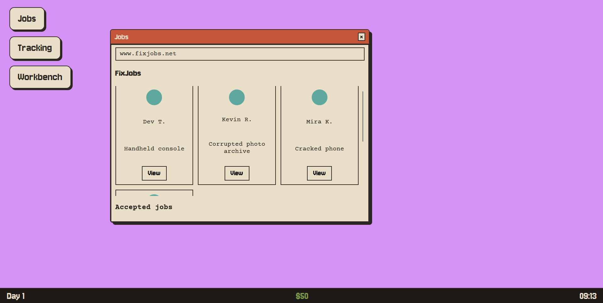
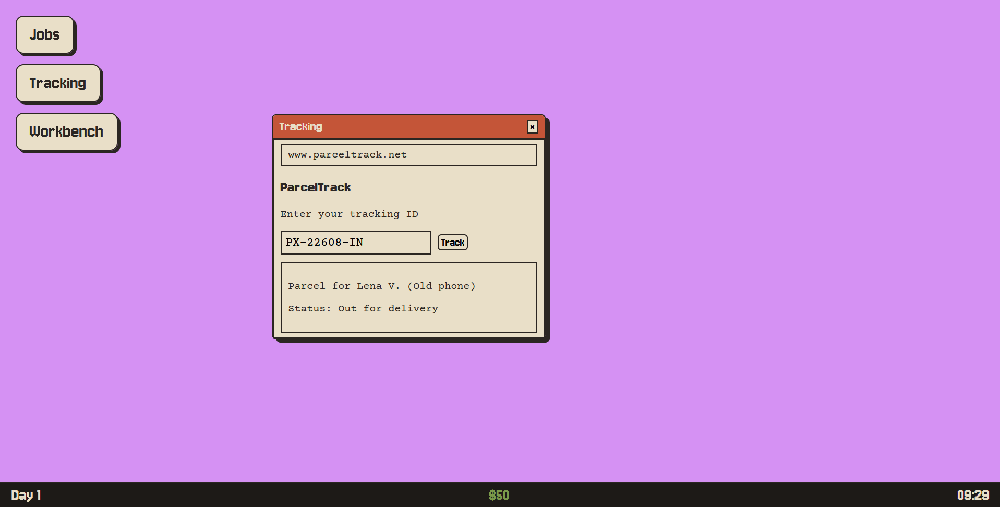
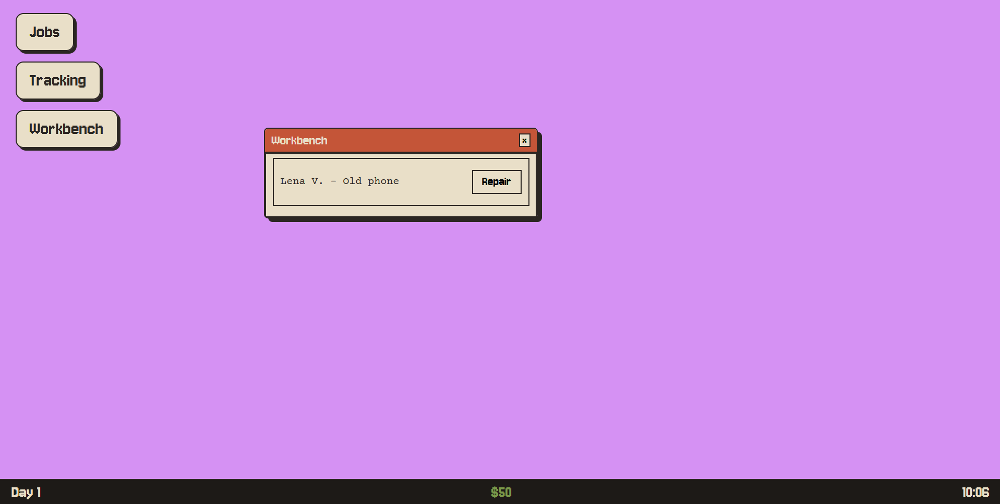

# Fix.exe
A small browser game where you run a repair shop from a fake computer desktop.

## What is it?
Fix.exe is a game where you are a repair technician. Customers post jobs on a fake website. You accept the jobs, wait for the parcels to arrive, and then fix the broken devices with two minigames. Every fix pays you money. But be careful, because some customers are scammers!

## Play it online
[Click here to play](https://nikhilkshub.github.io/Fix.exe/)

## Screenshots

## The story
I wanted to make a game with repair minigames these minigames were inspiration from a bigger game but those inspirations and the current version are not quite similar because as I progressed with development, the idea evolved and gradually became what it is now. Also the main bigger game had proper characters, animations, environments and other things and I could not build a full game with characters and animations. So I turned the shop into a fake desktop with three apps: Jobs, Tracking and Workbench.

## How to play
1. Read the short intro and press Start. A day runs from 09:00 to 18:00, which is about 9 real minutes.
2. Open the **Jobs** app. Click **View** on a customer, read their story, and press **Accept**.
3. You get a tracking ID. Paste it into the **Tracking** app to see where your parcel is. It takes a little while. If it says "Packed", the game is not broken, the courier is just slow.
4. When the parcel is delivered, it shows up in the **Workbench**. Press **Repair**.
5. Finish the minigame to get paid.

### The two minigames
**Frequency.** A phone screen is glitching. Move the three sliders (Wobble, Static and Roll) until the home screen is clear. The signal number tells you how close you are.
**Data Recovery.** Use the arrow keys or WASD. Walk into the dark area to draw a line, then go back to the safe edge to close off an area. Any dark area without a virus in it turns back into the picture. If a virus touches your line, you lose a heart. Recover 88% of the board before you lose all 3 hearts. When you win, the whole picture is revealed.

### Watch out for scams
Some customers are scammers. Warning signs are strange links, very high pay, and asking you to confirm things. If you click a scam link, fake virus windows will pop up and take a little of your money until you close them all. It is only a joke and nothing real happens, but a loud voice plays, so check your volume.

## Built with
- HTML, CSS and JavaScript. No frameworks and no libraries.
- The HTML canvas for both minigames.
- Fonts from Google Fonts: Jersey 10 and Courier Prime.
- 
## How to run it
You do not need to install anything.
1. Download this repo, or clone it:
2. Open the folder.
3. Open `index.html` in a browser like Chrome, Edge or Firefox.

## Project files
- `index.html`: the page and all the windows
- `style.css`: the look of the game
- `script.js`: the game logic
- `jobs.js`: the list of customers and their stories
- `assets/`: pictures, icons and sound

## How it works
The game clock is just one number that counts minutes. One real second is one game minute. Parcels, new jobs and delivery times are all based on that number.
In the Frequency game, the clean phone screen is drawn once on a hidden canvas. The visible screen redraws it many times a second, cutting it into thin strips and shifting them to make the wobble, adding random dots for static, and moving the strips down for the roll. Each slider controls one effect, and when all three are near their hidden targets, the screen is clear.
In the Data Recovery game, the board is a grid of squares. Each square is either corrupted, recovered, or part of the line you are drawing. When you close a line, a flood fill starts from each virus and marks every dark square it can reach. Any dark square the viruses cannot reach becomes recovered.

## Known limits
- It is made for a computer with a keyboard, not for phones.
- There is no save. If you refresh the page, you start again.
- There is no ending yet. You can keep playing until the customers run out.

## Credits
- App icons: Flaticon(website)
- Photos in Data Recovery: Pinterest
- Virus voice sound: [audio](https://www.myinstants.com/en/instant/virus-indian-song-76314/)
- Fonts: Google Fonts

## How I used AI
I used AI tools while making this project, mostly Claude, and ChatGPT to help me understand some of the steps. Here is what they did and what I did myself.

**Explaining concepts.** A lot of the ideas were new to me, so I asked the AI to explain them in plain words before I wrote the code. For example:
- How the Frequency minigame works: the phone screen is cut into thin strips, and each strip is moved sideways using a sine wave to make the wobble.
- How the Data Recovery minigame works: the board is a grid of squares, and a flood fill (like spilling paint) finds which dark areas the viruses can't reach.
- How a game loop works with `setInterval`, how to drag windows with mouse events, and why a picture has to be drawn only after it has finished loading.

I typed the code myself and tested after every step. For the hardest parts, like the flood fill and the screen distortion, the AI described the approach and I wrote the code from that. It also suggested the colors and fonts, and I changed some of them.
When something broke and I couldn't solve it myself, I showed the AI my code and screenshots, and it helped me find the cause. Some examples:
- The Data Recovery window and the canvas did not line up. I had given the window a fixed size, but the canvas sized itself from the screen height, so they never matched.
- A CSS line, `calc(100vh-340px)`, was ignored by the browser because it needs spaces around the minus sign.
- A one-letter typo (`recoveryPhoto.length` instead of `recoveryPhotos.length`) meant the picture never loaded.
- A CSS rule started with `.` instead of `#`, so the repair screen had no styling at all.

**Customer stories and text.**  It edited them and fixed the typos and grammar. It also helped me tidy my other stories.

**What was my own work.** The big ideas were mine: the fake desktop instead of a full shop, the tracking IDs, the scam links with fake virus windows and the voice, jobs arriving at random times, the full-screen repair screen, the mini games, and the intro window. I chose all the pictures and icons, tested everything, and decided how the game should feel, like counting the whole board for the percentage and revealing the picture when you win. I wrote the code myself.

## Made by
Nikhil Kunwar
